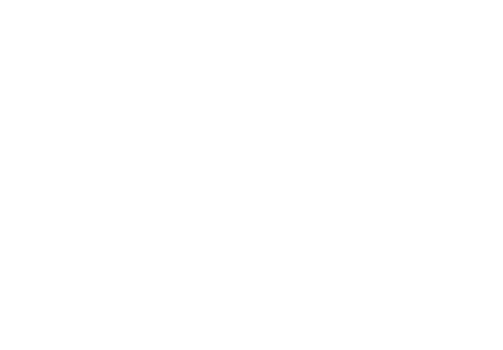

# Daymark

A quiet, local screen time journal for Ubuntu GNOME — the useful part of Screen
Time, without an account, a cloud, a web view or a permanent performance tax.



Daymark shows one day at a time: how long you used the computer, how that
compares with your own history, the shape of the week, the rhythm of the day,
and which applications received the time. Everything is stored on this machine.

| Dark | History | Settings |
| --- | --- | --- |
|  |  |  |

## Install

### Requirements

- Ubuntu 26.04 with GNOME Shell 50.1 was used for the tested build. The source
  targets GNOME Shell 45–50; build from source on older distributions (the
  prebuilt artifact links the build machine's glibc).
- Wayland is the default target. An optional X11 window backend is available.
- To build: Rust 1.85+, `build-essential`, `pkg-config`, and `libsqlite3-dev`.

```bash
sudo apt install build-essential pkg-config libsqlite3-dev
cargo build --release
./target/release/daymark
```

For a user-level installation (no root):

```bash
./install.sh
```

This copies the binary to `~/.local/bin/daymark`, installs the icon, the
desktop entry, an autostart entry, and the small GNOME companion extension. It
also enables the extension for your user.

**First install needs one sign-out and sign-in.** GNOME on Wayland only scans
for new Shell extensions at login. Daymark's setup sheet explains this; the
extension is already installed and will begin reporting after the next login.
Closing the window does not quit Daymark: tracking continues and the window can
be reopened from the application grid.

For GNOME on Xorg, build with the optional backend:

```bash
./install.sh --x11
# or: cargo build --release --features x11
```

The default Wayland-only build was chosen to keep the executable below 5 MB.

### Remove

```bash
./install.sh --uninstall          # keeps recorded history
./install.sh --uninstall --purge  # deletes local history too
```

## Use

- Click a day in the weekly chart, or use `←` / `→` to move one day.
- `T` returns to today, `Ctrl+1` / `Ctrl+2` switch between Day and History.
- `Ctrl+,` opens Settings; `Ctrl+W` hides the window; `Ctrl+Q` quits completely.
- History lists the last 14 days; click any row to inspect that day.
- Search filters the application list by name.
- Settings holds the idle timeout, history retention, appearance, autostart,
  pause/resume, an "open data folder" shortcut, and quit/delete actions.

## How tracking works

A GNOME Shell companion (`extension/`, UUID `daymark@daymark.app`) watches the
focused application with Mutter's `focus_window` and `Shell.WindowTracker`. It
publishes only this to `$XDG_RUNTIME_DIR/daymark/state.json`:

- application identity (desktop id or WM class) and display name
- tethered idle/locked/away state and the precise moment input stopped
- a heartbeat

It never reads window titles, keystrokes, clipboard data, screenshots or
application content. There is no networking code.

The Rust tracker reads that small file every two seconds. It records
non-overlapping intervals in SQLite, closes them on focus change, idle, lock,
sleep or pause, and writes a heartbeat every 30 seconds. Idle time is
retroactively trimmed to the moment the extension says input stopped. Sleep and
wall-clock jumps do not accrue because durations are accumulated with a
monotonic clock. Sessions that cross midnight are split visually by day; the
tracker also starts a fresh row at midnight. Closed intervals are aggregated
with overlap clamping, so a day's totals are always computed from stored data.

On startup any open interval left by a crash is closed at its last heartbeat,
so hours spent with the machine off or the app dead are never credited. A
partial unique index on `sessions(is_open)` makes two simultaneous open
intervals impossible.

Idle detection uses Mutter's core idle monitor with configurable watchers
(1–15 minutes in the UI, default 5). Lock/presence uses GNOME's screen shield
signals; suspend uses systemd-logind's prepare-for-sleep signal; idle inhibitors
(a video, a presentation) are respected. The tracker also independently closes
the current interval on a wall-clock/monotonic discontinuity, so a missed
suspend signal cannot turn sleep into usage.

### Why an extension?

On GNOME Wayland, arbitrary clients cannot ask which window has focus. X11
tools such as `_NET_ACTIVE_WINDOW` see only XWayland clients, not native
Wayland windows. GNOME's own focus API is Shell-internal. A small Shell
extension is therefore the supported, stable mechanism; it is deliberately
limited to the identity/state above. The app honestly reports when the
companion is missing or has not yet been activated and walks through the
one-time login step.

## Data and privacy

- Database: `~/.local/share/daymark/daymark.db` (mode 0700 directory).
- Runtime state: `$XDG_RUNTIME_DIR/daymark/state.json`, mode 0600.
- Settings: stored in the same SQLite database.
- Autostart: `~/.config/autostart/daymark.desktop` (user-level only).
- Retention: 90 days, 1 year (default), or forever. Pruning deletes old
  sessions and orphaned application rows.
- No analytics, telemetry, network access, titles, keystrokes, screenshots, or
  clipboard contents.

A fresh database is 4 KB; the WAL is typically about 40 KB while Daymark runs
and is checkpointed normally.

## Implementation notes

- Rust 2024, Slint 1.8 with the **software renderer** (no WebView, no Node, no
  browser engine, no GPU requirement), SQLite through `rusqlite` linked to the
  system SQLite, and a 4-thread process (UI, tracker, IPC, clipboard helper).
- The system's Ubuntu Sans and installed PNG application icons are used. SVG- or
  missing-icon applications fall back to a quiet colored initial tile.
- Slint is pinned to 1.8 on purpose. Slint 1.18's Parley/ICU text stack plus
  its image/SVG dependencies made even a minimal build about 10 MB; 1.8 keeps
  the full dashboard at 4.55 MB without giving up the design.
- SQLite is linked dynamically to the copy every Ubuntu desktop already has,
  rather than embedding a second copy.
- One local Unix socket plus `flock` provides single-instance behavior; a second
  launch shows the existing window instead of starting another tracker.

## Measured results

Measured on Ubuntu 26.04, GNOME Shell 50.1, Wayland, x86_64, release build:

| Item | Result |
| --- | ---: |
| Stripped executable | **4,552,088 bytes (4.34 MiB)** |
| Installed application files (binary, icon, entries, extension) | ≈ 4.57 MB |
| Fresh database | 4 KB |
| Hidden RSS | ≈ 18 MB |
| Hidden CPU, 20 s sample | 0.0% (0 ticks at 100 Hz) |
| Hidden wakeups | ≈ 1.4/s |
| Visible RSS | ≈ 36 MB |
| Visible CPU, 30 s sample | 0.23% |
| Visible wakeups | ≈ 12/s |

CPU is from `/proc/<pid>/stat` (`utime+stime` ticks / 100 Hz / interval); RSS
from `/proc/<pid>/status`; samples were taken after a 5–15 second settle.
Wakeups are voluntary context switches per second. Dynamic dependencies:
`libsqlite3.so.0`, `libc`, `libm`, `libgcc_s`; the GNOME/Wayland libraries are
already part of the desktop session. The default binary is Wayland-only; the
optional X11 backend adds code and is not included in these measurements.

## Verification

- `cargo test --lib`: **34 passed** — date/DST arithmetic and midnight bounds,
  interval overlap and hourly aggregation, idle-gap exclusion, per-app totals,
  averages, JSON parsing, desktop-entry parsing, SQLite persistence, corruption
  recovery, crash recovery, at-most-one-open-session, pruning, settings, single
  instance, and tracker focus/pause/idle behavior.
- The real release binary was launched on the live GNOME 50.1 Wayland session
  (hidden and visible), with a second instance proving single-instance
  forwarding, `--quit` shutdown, autostart creation, and database initialization.
- An end-to-end run fed the real tracker a synthetic extension state file; two
  focus intervals were written and idle truncation applied.
- The companion was loaded by a headless GNOME Shell 50.1 session: it created
  the state file, advanced its heartbeat, honored a 30-second idle threshold,
  reported `away`, and shut down cleanly. Active-window focus transitions could
  not be exercised in that headless seat (no focused window exists), so the
  final focus switch awaits the user's first real login with the extension
  active. The same Mutter `focus_window`/`Shell.WindowTracker` API is used by
  the already-working screen-time extension on this machine.
- Visual states (light, dark, populated, empty, first-run setup, history,
  settings, error) were rendered through the application's own software
  renderer with deterministic data at 1120×780 and inspected. GNOME's screenshot
  D-Bus API denied external capture in this session, so the images in `docs/`
  are true renderer output rather than compositor grabs.

## Known limitations

- **Wayland focus tracking needs the GNOME companion and one logout/login after
  installation.** This is a GNOME extension-loading rule, not a Daymark
  workaround; the app says so in its setup flow. Locked/suspended periods are
  intentionally not counted.
- The default binary is Wayland-only for size. Use `--features x11` on an Xorg
  session. Lock and suspend handling is implemented against GNOME's screen
  shield and logind signals; only the idle path was exercised in the headless
  integration test and a live lock/unlock was not possible here.
- Slint 1.8's size-optimized build does not expose screen-reader tree metadata.
  Contrast, large targets, and keyboard shortcuts are provided; screen-reader
  support would require a larger accessibility-enabled UI build.
- SVG-only application icons fall back to a colored initial because no SVG
  renderer is bundled. Most Ubuntu apps ship PNG icons and render normally.
- If the GNOME companion stops reporting, Daymark stops recording rather than
  guessing; the dashboard explains this and links to setup again.

## Source layout

```
src/main.rs           lifecycle, single instance, event loop
src/app.rs            UI controller and model building
src/tracker.rs        focus state file → intervals
src/db.rs             SQLite schema, recovery, queries
src/stats.rs          pure day/hour/app aggregation
src/desktop.rs        .desktop metadata and icon lookup
src/date.rs           local dates, DST-safe boundaries, formatting
src/json.rs           tiny JSON reader for the companion state
src/platform.rs       autostart, extension install, theme detection
src/instance.rs       flock + Unix socket IPC
src/bin/render.rs     deterministic screenshot renderer (dev tool)
ui/                   Slint dashboard and design tokens
extension/            GNOME Shell companion (GJS)
packaging/            reference desktop entries
docs/                 rendered screenshots
```

To regenerate the screenshots:

```bash
cargo build --bin render
./target/debug/render --out docs/daymark-light.png --state light
./target/debug/render --out docs/daymark-dark.png --state dark
./target/debug/render --out docs/daymark-history.png --state history
./target/debug/render --out docs/daymark-settings.png --state settings
```

## License

MIT. See [LICENSE](LICENSE).
