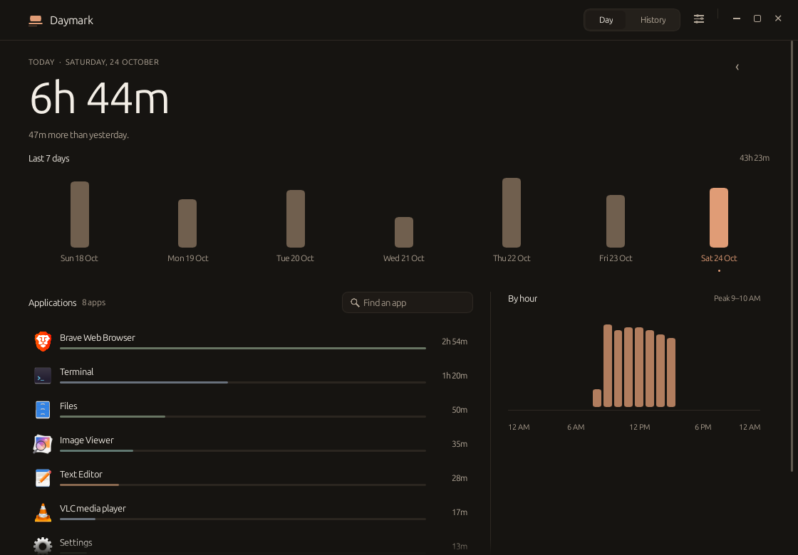
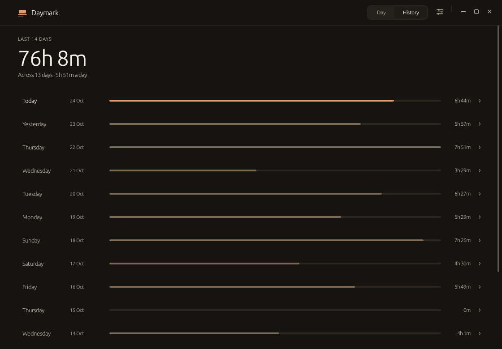
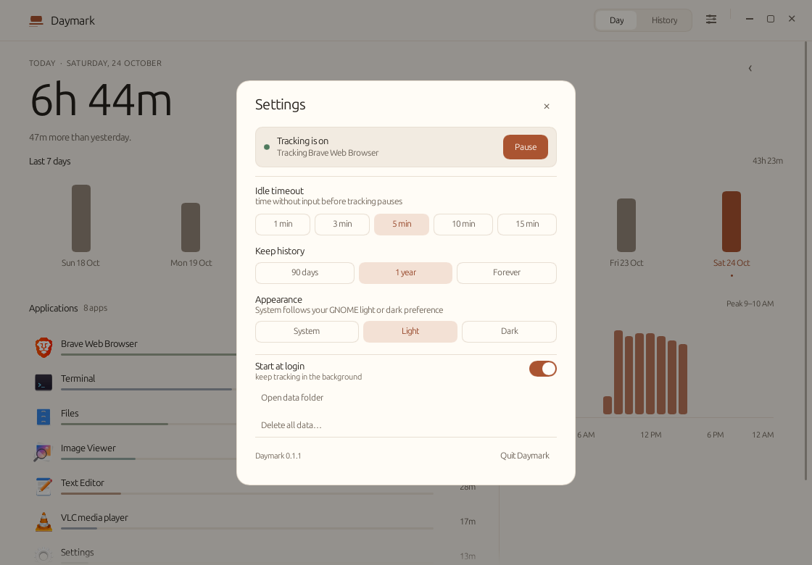
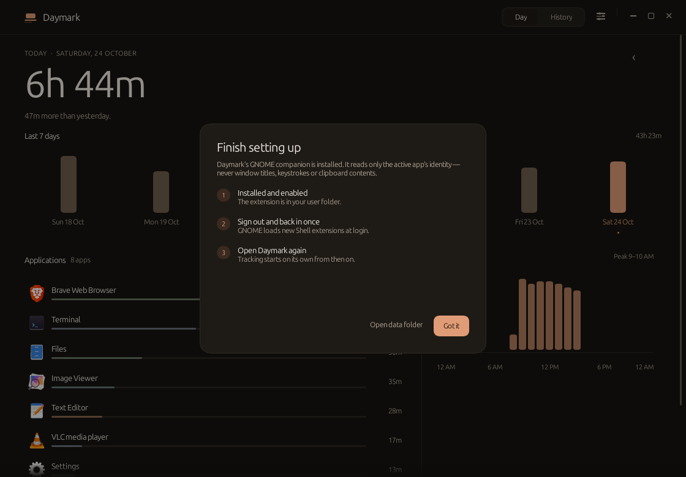
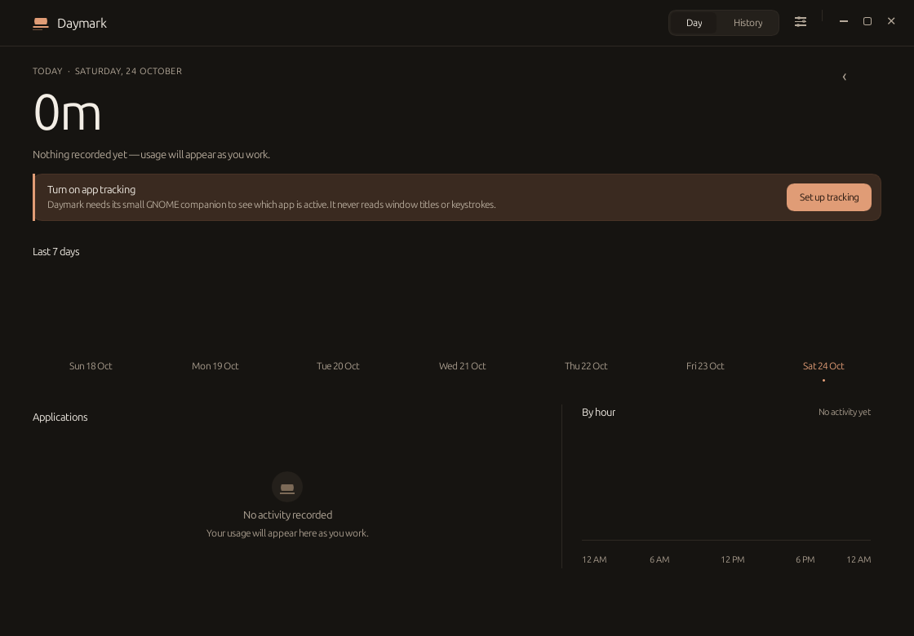

<h1 align="center">
  
  &nbsp;Daymark
</h1>

<p align="center">
  <strong>A quiet, local screen time journal for GNOME.</strong><br />
  The useful part of Screen Time — without an account, a cloud, a web view,
  or a permanent performance tax.
</p>

<h4 align="center">
  <a href="#install">Install</a> |
  <a href="#use">Use</a> |
  <a href="#how-it-works">How it works</a> |
  <a href="#privacy">Privacy</a> |
  <a href="#build-from-source">Build from source</a> |
  <a href="#verification">Verification</a>
</h4>

<p align="center">
  
  
  
  
</p>

<p align="center">
  <a href="docs/media/daymark-tour.mp4">
    
  </a>
</p>

<p align="center">
  <sub>22-second tour · <a href="docs/media/daymark-tour.mp4">MP4 version</a></sub>
</p>

One day at a time. Daymark shows how long you used the computer, where the time
went, and how that compares with your own history. It asks for no account, opens
no browser engine, makes no network requests, and keeps everything in one small
SQLite file on the machine in front of you.

The window is a real native app: 8.4 MiB on disk, about 8 MB of memory while
hidden in the background, no idle CPU, and no wakeups until there is something
to do.

## What you get

| You get | You never get |
| --- | --- |
| One calm day view — total time, the week's shape, the day's rhythm | Sign-ups, profiles or a subscription |
| A per-app breakdown with real icons and quiet time bars | Window titles, keystrokes, clipboard data or screenshots |
| Fourteen days of history at a glance | Cloud sync, analytics, telemetry or any network code |
| System light/dark that follows GNOME live | A WebView, Electron or Node runtime |
| A small GNOME companion that publishes one JSON file | A background process that thinks while you are idle |

## Screenshots

| Dark | History | Settings |
| --- | --- | --- |
|  |  |  |
| **Setup** | **First run** | |
|  |  | |

## Install

Daymark targets **Ubuntu with GNOME 45–50** and has been tested on Ubuntu 26.04
with GNOME Shell 50.1. The build includes both the Wayland and X11 window
backends.

```bash
git clone https://github.com/101xAnshu/daymark.git
cd daymark
./install.sh
```

No root is needed. The installer puts the binary in `~/.local/bin`, adds the
desktop entry and icon, enables autostart, and installs and enables the small
GNOME companion. It builds from source unless you pass `--no-build`.

**The first install needs one sign-out and sign-in.** GNOME on Wayland only scans
for new Shell extensions at login; Daymark's setup sheet explains this and the
extension begins reporting on the next login.

To remove it:

```bash
./install.sh --uninstall          # keeps your recorded history
./install.sh --uninstall --purge  # deletes local history too
```

## Use

- Click a day in the weekly chart, or use `←` / `→` to move one day.
- `T` returns to today; `Ctrl+1` / `Ctrl+2` switch between Day and History.
- `Ctrl+,` opens Settings. `Ctrl+W` hides the window. `Ctrl+Q` quits.
- The ✕ control (or Alt+F4) hides Daymark and keeps tracking in the background;
  **Quit Daymark** in Settings really stops it.
- Search filters the application list by name. Clicking anywhere outside the
  field releases focus.
- Settings holds the idle timeout, retention, appearance, autostart, pause,
  the data folder shortcut, and delete/quit actions.

## How it works

On GNOME Wayland, a normal application cannot ask which window has focus; X11
tools only see XWayland clients. GNOME's focus API is Shell-internal. Daymark
uses the supported mechanism: a deliberately tiny GNOME Shell companion
(`extension/`, UUID `daymark@daymark.app`).

The companion publishes only this to `$XDG_RUNTIME_DIR/daymark/state.json`:

- the focused application's identity (desktop id or WM class) and display name
- idle, locked and away state, and the precise moment input stopped
- a heartbeat

It never reads window titles, keystrokes, clipboard data, screenshots or
application content, and it contains no networking code.

The Rust tracker reads that file every two seconds and stores non-overlapping
intervals in SQLite. It closes them on focus change, idle, lock, sleep or pause,
and writes a heartbeat every 30 seconds. Idle time is trimmed back to the moment
the companion says input stopped. Sleep and wall-clock jumps accrue nothing
because durations use a monotonic clock. Sessions that cross midnight are split,
and closed intervals are aggregated with overlap clamping, so a day's totals
always come from stored data.

GNOME Shell's own surfaces are filtered out: the `gjs` host processes
(notifications, screen saver), the desktop-icons window, docks and other
non-application window types are never recorded as apps. A one-time migration
also merges old fallback rows into their real desktop entries and removes
shell-internal rows.

On startup any open interval left by a crash is closed at its last heartbeat, so
hours with the machine off or the app dead are never credited. A partial unique
index on `sessions(is_open)` makes two simultaneous open intervals impossible.

Idle detection uses Mutter's core idle monitor with the configured 1–15 minute
threshold (5 by default). Lock and presence use GNOME's screen shield signals;
suspend uses systemd-logind's prepare-for-sleep signal; idle inhibitors (a video,
a presentation) are respected. The tracker also closes the current interval on a
wall-clock/monotonic discontinuity, so a missed suspend signal cannot turn sleep
into usage.

If the companion stops reporting, Daymark stops recording rather than guessing;
the dashboard says so and links back to setup.

## Privacy

- Database: `~/.local/share/daymark/daymark.db` (directory mode `0700`).
- Runtime state: `$XDG_RUNTIME_DIR/daymark/state.json` (mode `0600`).
- Settings live in the same SQLite database.
- Autostart: `~/.config/autostart/daymark.desktop` (user-level only).
- Retention: 90 days, 1 year (default), or forever. Pruning removes old sessions
  and orphaned application rows.
- No analytics, telemetry, network access, window titles, keystrokes,
  screenshots or clipboard contents.

A fresh database is 4 KB; the WAL is typically about 40 KB while Daymark runs and
is checkpointed normally.

## Build from source

Requirements: Rust 1.85+, `build-essential`, and `pkg-config`. SQLite is compiled
in, so no separate SQLite development package is needed.

```bash
sudo apt install build-essential pkg-config
cargo build --release
./target/release/daymark
```

The binary is self-contained apart from the C library, `libm`, `libgcc_s` and the
desktop session's Wayland/X11 libraries. The same build runs on Xorg; the old
`--x11` installer flag is still accepted for compatibility.

`--background` is genuinely invisible: no window, no Slint platform and no event
loop exist until the interface is requested. The UI is created lazily when you
open Daymark from the application grid.

## Verification

- `cargo test --lib`: **38 passed** — date/DST arithmetic and midnight bounds,
  interval overlap and hourly aggregation, idle-gap exclusion, per-app totals,
  averages, JSON parsing (including the seconds/milliseconds compatibility
  path), desktop-entry parsing (quoted `Exec`, `NoDisplay`, hidden entries),
  shell-window filtering, SQLite persistence, legacy-row migration, corruption
  recovery, crash recovery, at-most-one-open-session, pruning, settings, single
  instance, and tracker focus/pause/idle behavior.
- The release binary was run on a live GNOME 50.1 Wayland session. The window
  reaches GNOME with app id/WM class `daymark`, so the shell matches it to the
  desktop entry and the companion reports `daymark.desktop` instead of an
  "Unknown" window-backed app.
- `--background` created no window and no Slint event loop: **8.2 MB RSS, 0% CPU
  and 0 wakeups/s** over a 20-second sample. A second launch shows the headless
  instance; `--quit` stops it cleanly.
- The one-time migration ran on the live database (a backup copy was taken
  first): the `gjs` row and its sessions were removed and the
  `wm_class:com.t3tools.t3code` fallback row was merged into
  `com.t3tools.T3Code.desktop`, keeping its icon and duration.
- The companion was loaded by a headless GNOME Shell 50.1 session: it created
  the state file, advanced its heartbeat, honored the idle threshold, reported
  `away`, and shut down cleanly.
- Visual states (light, dark, populated, empty, first run, setup, history,
  settings, error and focused search) were rendered through the application's
  own software renderer at 1120×780 and 900×620 and inspected. Snapshots are
  written opaque, so the images in `docs/` display correctly everywhere.

## Measured results

Measured on Ubuntu 26.04, GNOME Shell 50.1, Wayland, x86_64, release build:

| Item | Result |
| --- | ---: |
| Stripped executable | **8,822,768 bytes (8.41 MiB)** |
| Installed application files (binary, icon, entries, extension) | ≈ 8.9 MB |
| Fresh database | 4 KB |
| Hidden RSS | ≈ 8.2 MB |
| Hidden CPU, 20 s sample | 0.0% (0 ticks at 100 Hz) |
| Hidden wakeups | 0/s (blocked on IPC) |
| Visible RSS | ≈ 27 MB |
| Visible CPU, 10 s sample | 0.0% |
| Visible wakeups | ≈ 1.4/s |
| Threads | 3 hidden / 7 visible |

CPU is from `/proc/<pid>/stat` (`utime+stime` ticks / 100 Hz / interval); RSS from
`/proc/<pid>/status`; samples were taken after a 4 second settle. Wakeups are
voluntary context switches per second. Dynamic dependencies: `libc`, `libm`,
`libgcc_s`; the GNOME/Wayland libraries are already part of the session. SQLite
is compiled in. The binary sits below the 10 MB budget; that budget paid for SVG
icons, AccessKit accessibility and the X11 backend.

## Known limitations

- **Wayland focus tracking needs the GNOME companion and one logout/login after
  installation.** This is a GNOME extension-loading rule, not a Daymark
  workaround; the app says so in its setup flow. Updating an already-loaded
  extension also needs a re-login before GNOME executes the new file.
- GNOME Shell surfaces are filtered, but a future Shell version could introduce
  a new internal surface type; the app keeps a deny-list as a second line of
  defence.
- Lock and suspend handling is implemented against GNOME's screen shield and
  logind signals; the idle path is covered by the headless integration test.
- Accessibility exposes roles and labels (AccessKit), not a hand-tuned
  screen-reader reading order. Contrast, large targets and full keyboard
  shortcuts are provided.
- If the companion stops reporting, Daymark stops recording rather than
  guessing.

## Source layout

```
src/main.rs           lifecycle, single instance, event loop
src/app.rs            UI controller and model building
src/tracker.rs        focus state file → intervals
src/db.rs             SQLite schema, migration, recovery, queries
src/stats.rs          pure day/hour/app aggregation
src/desktop.rs        .desktop metadata and icon lookup
src/date.rs           local dates, DST-safe boundaries, formatting
src/json.rs           tiny JSON reader for the companion state
src/platform.rs       autostart, extension install, theme detection
src/instance.rs       flock + Unix socket IPC
ui/                   Slint dashboard and design tokens
extension/            GNOME Shell companion (GJS)
media/                Remotion project for the tour above
docs/                 rendered screenshots and media
vendor/               small Slint 1.8 backports (window identity, drag, hide)
```

### Media

The tour is generated from the real rendered UI with
[Remotion](https://www.remotion.dev/). The project and its sources live in
[`media/`](media/), and the README GIF is a downscaled version of the 1080p MP4:

```bash
cd media
npm install
./render.sh
```

## License

MIT. See [LICENSE](LICENSE).
