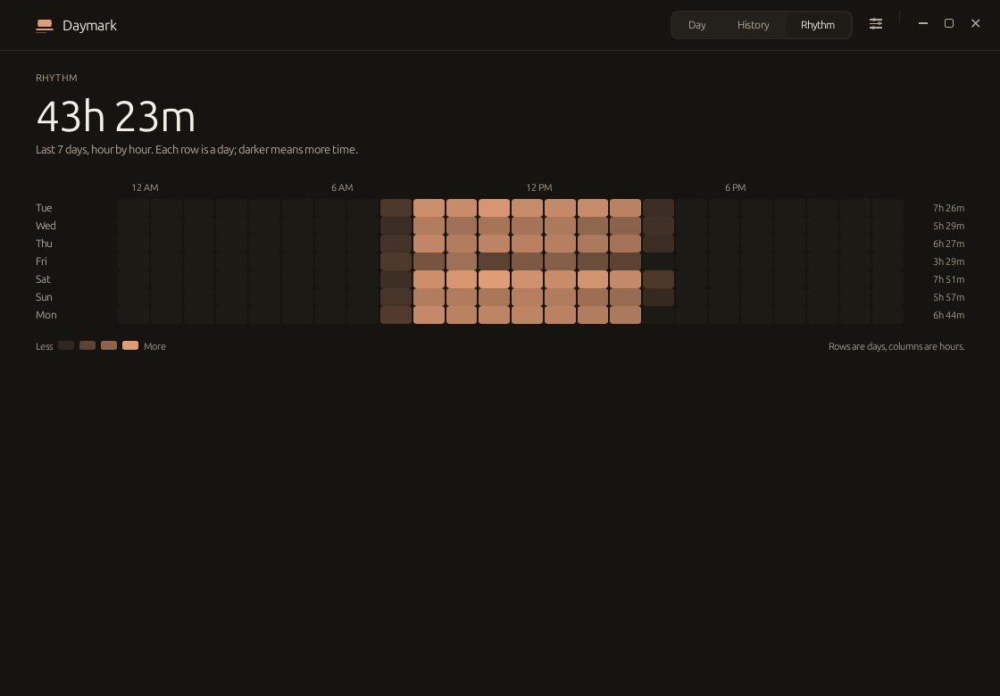

<h1 align="center">
  <sub></sub>
  &nbsp;Daymark
</h1>

<p align="center">
  <strong>A quiet, local screen time journal for GNOME.</strong><br />
  The useful part of Screen Time — without an account, a cloud, a web view,
  or a permanent performance tax.
</p>

<h4 align="center">
  <a href="#install">Install</a> |
  <a href="#use">Use</a> |
  <a href="#how-it-works">How it works</a> |
  <a href="#privacy">Privacy</a> |
  <a href="#build-from-source">Build from source</a> |
  <a href="#verification">Verification</a>
</h4>

<p align="center">
  
  
  
  
</p>

<p align="center">
  <a href="docs/media/daymark-tour.mp4">
    
  </a>
</p>

<p align="center">
  <sub>26-second tour · <a href="docs/media/daymark-tour.mp4">60 fps MP4 with sound</a></sub>
</p>

One day at a time. Daymark shows how long you used the computer, where the time
went, and how that compares with your own history. It asks for no account, opens
no browser engine, makes no network requests, and keeps everything in one small
SQLite file on the machine in front of you.

The window is a real native app: 8.7 MiB on disk. Started at login with
`--background`, it opens no window and creates no Slint platform or event loop:
about 8 MB of memory, 0% idle CPU, and no timed polling while the companion is
quiet. The tracker waits on an inotify watch and wakes when the companion
publishes a change, with a 30-second safety check. Once you open the window, the
interface stays alive for the rest of the process, including after you close it
to the background. That costs about 24 MB and keeps the tracker watch, so it is
not the headless footprint.

## What you get

| You get | You never get |
| --- | --- |
| One calm day view — total time, a metrics row, a 24-hour timeline, the week's shape and the day's rhythm | Sign-ups, profiles or a subscription |
| A seven-day rhythm view — a 7×24 heatmap of when the week is busy | Streaks, scores or guilt mechanics |
| A per-app breakdown with real icons and quiet time bars | Window titles, keystrokes, clipboard data or screenshots |
| Fourteen days of history at a glance | Cloud sync, analytics, telemetry or any network code |
| System light/dark that follows GNOME live | A WebView, Electron or Node runtime |
| A small GNOME companion that publishes one JSON file | A background process that animates or redraws while you are idle |

## Screenshots

| Dark | History | Settings |
| --- | --- | --- |
|  |  |  |
| **Setup** | **First run** | |
|  |  | |

<p align="center">
  
</p>

## Install

Daymark targets **Ubuntu 24.04+** (GNOME 46+) and **Fedora 42+** (GNOME 48+).
It has been tested on Ubuntu 26.04 with GNOME Shell 50.1, and the packages are
built for amd64/x86_64. The `.deb` is built on Ubuntu 22.04 for the glibc 2.35
floor; Ubuntu 22.04 itself is not a supported runtime because it ships GNOME 42.
The build includes both the Wayland and X11 window backends.

### Ubuntu package

Ubuntu 24.04 or newer with GNOME 46 or newer is required. Ubuntu 22.04 ships
GNOME 42, which the companion does not support.

Download `daymark_<version>_amd64.deb` from the latest release and install it:

```bash
sudo apt install ./daymark_0.1.1_amd64.deb
```

### Fedora package

Fedora 42 or newer with GNOME 48 or newer is required. Download
`daymark-<version>-1.x86_64.rpm` from the latest release and install it:

```bash
sudo dnf install ./daymark-*.rpm
```

Both packages install the binary in `/usr/bin/daymark` together with the
desktop entry, icon and GNOME Shell companion. The companion ships
system-wide at `/usr/share/gnome-shell/extensions/daymark@daymark.app`; the
app enables that copy for your user and never copies extension files into
your home directory, so package upgrades apply to every user on their own.
The packages start no service and change no user settings at install time.
Remove one with `sudo apt remove daymark` or `sudo dnf remove daymark`;
recorded history is kept in your home directory.

### From source

```bash
git clone https://github.com/101xAnshu/daymark.git
cd daymark
./install.sh
```

No root is needed. The installer puts the binary in `~/.local/bin`, adds the
desktop entry and icon, enables autostart, and installs the small GNOME
companion into your user extension folder (`~/.local/share/gnome-shell/
extensions`) — the app enables whichever copy exists, preferring the
system-wide one when a package provided it. `install.sh` builds from source
unless you pass `--no-build`.

### Portable archive (fallback)

The release also includes `daymark-<version>-x86_64-linux.tar.gz` for systems
where a package cannot be used. It contains the release binary and
`install.sh`:

```bash
tar -xzf daymark-0.1.1-x86_64-linux.tar.gz
cd daymark-0.1.1
./install.sh --no-build
```

**The first install needs one sign-out and sign-in, and each companion update
needs one too.** GNOME on Wayland loads extension code only when the Shell
session starts. It does not pick up a newly installed or newly replaced
`extension.js` while that session is running, so the setup sheet asks for one
sign-out/sign-in after installation. A package update that changes the companion
takes effect at the next login for the same reason. Disabling and re-enabling
the extension, or restarting Daymark itself, does not reload it on Wayland.
Recorded history and settings are unaffected; tracking begins after that login.

### First run

The first time the Daymark window opens after installing, the setup sheet
appears on its own — once. It shows what was set up, explains the one
sign-out/sign-in, and offers a **Start at login** toggle that is applied when
you change it. The rest of the app stays usable behind the sheet, and the
sheet never nags again: the first run is remembered whether or not you finish
setup in that session. If tracking is already fully working on the first
launch, nothing opens at all.

Daymark enables autostart by default so tracking survives a reboot. If you
(or a startup tool) switched it off in the autostart entry itself with
`X-GNOME-Autostart-enabled=false` or `Hidden=true`, Daymark respects that
choice and never switches it back on at launch; turning the toggle on again
in Settings is a deliberate act and re-enables it.

To remove a source or archive install:

```bash
./install.sh --uninstall          # keeps your recorded history
./install.sh --uninstall --purge  # deletes local history too
```

### Optional systemd user service

The packages also install `daymark.service` in `/usr/lib/systemd/user`, but do
not enable it. If you prefer systemd over the XDG autostart entry:

```bash
systemctl --user enable --now daymark.service
```

Turn off **Start at login** in Settings so only one launcher starts Daymark. The
unit runs `daymark --background`, restarts on failure, and stops with the
graphical session.

## Use

- Click a day in the weekly chart, or use `←` / `→` to move one day.
- The day view opens with a quiet metrics row: the longest uninterrupted
  stretch, the number of distinct apps, the time recorded after midnight
  (00:00–05:00), and the change from the same weekday last week. A **Now**
  cell appears while a session is live today and shows the current app and its
  running time. There are no scores, streaks or targets.
- The 24-hour timeline draws each recorded session as a small block, coloured
  by app and clipped to the selected day. It comes from the same stored
  intervals as the rest of the view and holds no window titles, URLs or
  network data.
- `T` returns to today; `Ctrl+1` / `Ctrl+2` / `Ctrl+3` switch between Day,
  History and Rhythm.
- Rhythm shows the last seven days as a 7×24 heatmap: rows are days, columns
  are hours, and darker means more time.
- `Ctrl+,` opens Settings. `Ctrl+W` hides the window. `Ctrl+Q` quits.
- The ✕ control (or Alt+F4) hides Daymark and keeps tracking in the background;
  **Quit Daymark** in Settings really stops it. After the first open the process
  keeps the interface in memory while hidden; `--background` at login is the
  smaller headless mode.
- Search filters the application list by name. Clicking anywhere outside the
  field releases focus.
- Settings holds the idle timeout, retention, appearance, autostart, pause
  options (15 minutes, 1 hour, or until resumed), the data folder shortcut, and
  delete/quit actions. A timed pause ends by itself, even while the window is
  hidden; a pause without a deadline ends at the next app start.

## Diagnostics

Two small commands help when tracking looks wrong. Both work while Daymark is
running and neither changes recorded data.

```bash
daymark --status   # one stable line for scripts and panels
daymark doctor     # read-only database, companion and log report
```

`--status` prints one line in a fixed key/value form:

```
tracking=active pause=none app="Example Editor"
```

- `tracking` is `active`, `away`, `paused`, `stale` or `waiting`.
- `pause` is `none`, `until-resume`, or `until:<unix timestamp>`.
- `app` appears only while the companion state file is fresh (under 45 seconds)
  and a focused application is known. The value is quoted and escaped, so the
  rest of the line stays easy to split.

`doctor` reports the database path, schema version, database and WAL size,
heartbeat age, whether the companion state file is fresh, the open session and
today's row count, whether the companion is installed, enabled and which
version its `metadata.json` declares, whether autostart is installed, the
retention setting, and the last error in the log. The installed/version fields
follow the copy Daymark actually enables: the packaged system-wide companion
when it exists, otherwise the user-level one. `doctor` opens the database in
read-only mode: it never creates, migrates, recovers or writes it.

Logs are written under `$XDG_STATE_HOME/daymark/logs`, falling back to
`~/.local/state/daymark/logs`. One file is kept per local day, seven days are
retained, and each file is readable only by the current user. Only lifecycle
counts, timings and error text are logged; window titles, URLs and application
content never are.

## How it works

On GNOME Wayland, a normal application cannot ask which window has focus; X11
tools only see XWayland clients. GNOME's focus API is Shell-internal. Daymark
uses the supported mechanism: a deliberately tiny GNOME Shell companion
(`extension/`, UUID `daymark@daymark.app`).

The companion publishes only this to `$XDG_RUNTIME_DIR/daymark/state.json`:

- the focused application's identity (desktop id or WM class) and display name
- idle, locked and away state, and the precise moment input stopped
- a heartbeat

It never reads window titles, keystrokes, clipboard data, screenshots or
application content, and it contains no networking code.

The Rust tracker watches `$XDG_RUNTIME_DIR/daymark/` with inotify for the state
file being closed after a write, moved into place by an atomic replacement,
created, deleted or given new attributes. A focus, idle or lock change is
therefore handled as soon as the companion publishes it, usually within
milliseconds. A 30-second timeout re-reads the file in case an event was missed,
replacing the old two-second poll. If the runtime directory or the inotify watch
cannot be created, Daymark logs that once and falls back to the two-second poll.
The tracker stores non-overlapping intervals in SQLite. It closes them on focus
change, idle, lock, sleep or pause, and writes a heartbeat every 30 seconds.
Idle time is trimmed back to the moment the companion says input stopped. Sleep
and wall-clock jumps accrue nothing because durations use a monotonic clock.
Sessions that cross midnight are split, and closed intervals are aggregated with
overlap clamping, so a day's totals always come from stored data.

GNOME Shell's own surfaces are filtered out: the `gjs` host processes
(notifications, screen saver), the desktop-icons window, docks and other
non-application window types are never recorded as apps. A one-time migration
also merges old fallback rows into their real desktop entries and removes
shell-internal rows.

On startup any open interval left by a crash is closed at its last heartbeat, so
hours with the machine off or the app dead are never credited. A partial unique
index on `sessions(is_open)` makes two simultaneous open intervals impossible.

Idle detection uses Mutter's core idle monitor with the configured 1–15 minute
threshold (5 by default). Lock and presence use GNOME's screen shield signals;
suspend uses systemd-logind's prepare-for-sleep signal; idle inhibitors (a video,
a presentation) are respected. The tracker also closes the current interval on a
wall-clock/monotonic discontinuity, so a missed suspend signal cannot turn sleep
into usage.

If the companion stops reporting, Daymark stops recording rather than guessing;
the dashboard says so and links back to setup.

## Privacy

- Database: `~/.local/share/daymark/daymark.db` (directory mode `0700`).
- Runtime state: `$XDG_RUNTIME_DIR/daymark/state.json` (mode `0600`).
- Settings live in the same SQLite database.
- Autostart: `~/.config/autostart/daymark.desktop` (user-level only).
- Logs: `$XDG_STATE_HOME/daymark/logs` (fallback
  `~/.local/state/daymark/logs`), daily files kept for seven days. They contain
  counts, timings and error text only.
- Retention: 90 days, 1 year (default), or forever. Pruning removes old sessions
  and orphaned application rows.
- No analytics, telemetry, network access, window titles, keystrokes,
  screenshots or clipboard contents.

A fresh database is 4 KB; the WAL is typically about 40 KB while Daymark runs and
is checkpointed normally.

## Build from source

Requirements: Rust 1.85+, `build-essential`, and `pkg-config`. SQLite is compiled
in, so no separate SQLite development package is needed.

```bash
sudo apt install build-essential pkg-config
cargo build --release
./target/release/daymark
```

The binary is self-contained apart from the C library, `libm`, `libgcc_s` and the
desktop session's Wayland/X11 libraries. The same build runs on Xorg; the old
`--x11` installer flag is still accepted for compatibility.

`--background` is genuinely invisible: no window, no Slint platform and no event
loop exist until the interface is requested. The UI is created lazily when you
open Daymark from the application grid. The tracker still watches the companion
file and writes a heartbeat every 30 seconds, so the headless process wakes on
changes rather than polling twice a second. It keeps a 30-second timeout for a
missed event, and falls back to the two-second poll if the watch cannot be
created.

## Verification

- `cargo test --lib`: **93 passed** — date/DST arithmetic and midnight bounds,
  interval overlap and hourly aggregation, seven-day hourly heatmap aggregation
  across midnight, idle-gap exclusion, per-app totals, day metrics and timeline
  segmentation (empty days, gaps, overlaps, after-midnight and cross-midnight
  sessions), averages, JSON parsing (including the seconds/milliseconds compatibility
  path), desktop-entry parsing (quoted `Exec`, `NoDisplay`, hidden entries),
  shell-window filtering, SQLite persistence, legacy-row migration, corruption
  recovery, crash recovery, at-most-one-open-session, pruning, daily rollup
  preservation, repeated-prune safety, cross-midnight rollup, settings, single
  instance, tracker focus/pause/idle behavior, log rotation, extension copy
  selection (system-wide preferred, user folder as fallback), doctor reading the
  packaged system-wide companion and its version, the first-run decision,
  autostart-entry consent parsing (a deliberately disabled entry is left alone),
  read-only doctor/status formatting against a temporary database with its
  write connection still open, the inotify wait decision (event versus timeout),
  the 30-second watch versus the two-second fallback, the required watch mask,
  and a real watcher waking on a state-file write, an atomic replacement and a
  deletion, plus wake-pipe interruption, a private runtime directory, and an
  unwatchable path.
- The watch path was exercised with a real inotify watcher against temporary
  runtime directories. The live handoff from a GNOME companion focus change to
  the next tracker tick still needs a session with the companion loaded.
- The release binary was run on a live GNOME 50.1 Wayland session. The window
  reaches GNOME with app id/WM class `daymark`, so the shell matches it to the
  desktop entry and the companion reports `daymark.desktop` instead of an
  "Unknown" window-backed app.
- `--background` created no window and no Slint event loop. A 60-second run of
  `scripts/measure.sh` with temporary XDG directories measured **8.3–9.0 MiB RSS,
  0.00% CPU, 0.03 wakeups/s and 3 threads**; the single periodic wake is the
  30-second watch safety check. A second launch shows the running instance;
  `--quit` stops it cleanly.
- Closing the window leaves it unmapped, stops the 700 ms refresh timer, and
  still handles Show and Quit over the local socket. In the same live session
  (X11 backend on XWayland; native Wayland destroys the hidden surface instead),
  the hidden process held 23.8 MiB RSS at 0.00% CPU and 2.5 wakeups/s, down from
  3.9/s with the window open. That sample predates the watch, so its tracker
  share is now event-driven rather than a two-second poll; the remaining
  wakeups are event-loop housekeeping, and hidden-after-close is still not a
  zero-wakeup state.
- The one-time migration ran on the live database (a backup copy was taken
  first): the `gjs` row and its sessions were removed and the
  `wm_class:com.t3tools.t3code` fallback row was merged into
  `com.t3tools.T3Code.desktop`, keeping its icon and duration.
- The companion was loaded by a headless GNOME Shell 50.1 session: it created
  the state file, advanced its heartbeat, honored the idle threshold, reported
  `away`, and shut down cleanly.
- Visual states (light, dark, populated, empty, first run, setup, history,
  settings, error and focused search) were rendered through the application's
  own software renderer at 1120×780 and 900×620 and inspected. Snapshots are
  written opaque, so the images in `docs/` display correctly everywhere.

## Measured results

Measured on Ubuntu 26.04, GNOME Shell 50.1, Wayland, x86_64, release build.
The headless rows are from the watch build; the visible and hidden rows were
sampled before it, so their tracker poll is now event-driven.

| Item | Result |
| --- | ---: |
| Stripped executable | **9,140,976 bytes (8.72 MiB)** |
| Installed application files (binary, icon, entries, extension) | ≈ 9.2 MB |
| Fresh database | 4 KB |
| Headless RSS (`--background`) | 8.3–9.0 MiB across runs (≈ 8 MB) |
| Headless CPU, 60 s sample | 0.00% |
| Headless wakeups | 0.03/s (the 30-second safety check) |
| Visible RSS | ≈ 23.8 MB |
| Visible CPU, 20 s sample | 0.00% |
| Visible wakeups | ≈ 3.9/s |
| Hidden-after-close RSS | ≈ 23.8 MB |
| Hidden-after-close CPU | 0.00% (0 ticks at 100 Hz) |
| Hidden-after-close wakeups (pre-watch) | ≈ 2.5/s |
| Threads | 3 headless / 10 with the interface |

Headless numbers come from `scripts/measure.sh --seconds 60`, which starts the
release binary with temporary XDG directories and asks it to quit over its own
socket. The other rows were sampled the same way on a live session with the
X11 backend on XWayland; native Wayland destroys the hidden surface instead, so
its memory can be lower. Wakeups are total voluntary context switches per second
across every thread, not just the main thread. CPU is from `/proc/<pid>/stat`
(`utime+stime` ticks / 100 Hz / interval); RSS is from `/proc/<pid>/status`;
samples were taken after a 5 second settle.
Dynamic dependencies: `libc`, `libm`, `libgcc_s`; the GNOME/Wayland libraries
are already part of the session. SQLite is compiled in. The binary sits below
the 10 MB budget; that budget paid for SVG icons, AccessKit accessibility and
the X11 backend.

## Known limitations

- **Wayland focus tracking needs the GNOME companion, plus one logout/login
  after installing it and after each companion update.** GNOME on Wayland loads
  extension JavaScript once per Shell session and does not reload a replaced
  `extension.js`. This is a GNOME rule, not a Daymark workaround; the setup flow
  says so, and tracking begins after that login.
- GNOME Shell surfaces are filtered, but a future Shell version could introduce
  a new internal surface type; the app keeps a deny-list as a second line of
  defence.
- Lock and suspend handling is implemented against GNOME's screen shield and
  logind signals; the idle path is covered by the headless integration test.
- Accessibility exposes roles and labels (AccessKit), not a hand-tuned
  screen-reader reading order. Contrast, large targets and full keyboard
  shortcuts are provided.
- If the companion stops reporting, Daymark stops recording rather than
  guessing.

## Source layout

```
src/main.rs           lifecycle, single instance, event loop
src/app.rs            UI controller and model building
src/diagnostics.rs    read-only doctor and status summary
src/logging.rs        daily rotating lifecycle and error log
src/tracker.rs        focus state file → intervals
src/db.rs             SQLite schema, migration, recovery, queries
src/stats.rs          pure day/hour/app aggregation
src/desktop.rs        .desktop metadata and icon lookup
src/date.rs           local dates, DST-safe boundaries, formatting
src/json.rs           tiny JSON reader for the companion state
src/platform.rs       autostart, extension install, theme detection
src/instance.rs       flock + Unix socket IPC
ui/                   Slint dashboard and design tokens
extension/            GNOME Shell companion (GJS)
media/                Remotion project for the tour above
docs/                 rendered screenshots and media
vendor/               small Slint 1.8 backports (window identity, drag, hide)
```

### Media

The tour is a 60 fps [Remotion](https://www.remotion.dev/) composition that
rebuilds the interface from the same design tokens and application icons, so the
numbers, bars, search and rows can move. It has an original ambient score. The
project lives in [`media/`](media/); the README GIF is a downscaled version of
the 1080p MP4:

```bash
cd media
npm install
./render.sh
```

## License

MIT. See [LICENSE](LICENSE).
